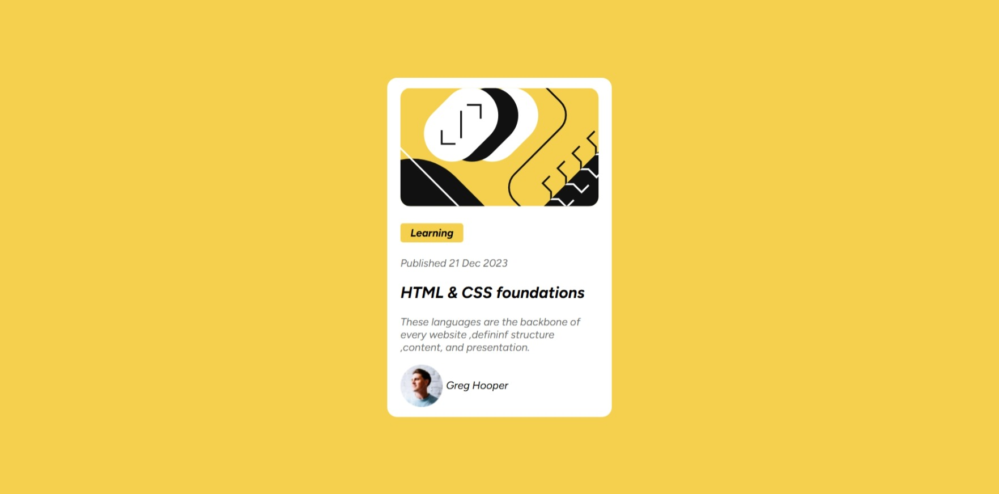

# Frontend Mentor - Blog Preview Card Solution

This is my solution to the [Blog preview card challenge on Frontend Mentor](https://www.frontendmentor.io/challenges/blog-preview-card-ckPaj01IcS).

Frontend Mentor challenges help developers improve their coding skills by building realistic projects from professional designs.

## Table of contents

- [Overview](#overview)
  - [The challenge](#the-challenge)
  - [Screenshot](#screenshot)

- [My process](#my-process)
  - [Built with](#built-with)
  - [What I learned](#what-i-learned)
  - [Continued development](#continued-development)
  - [Useful resources](#useful-resources)
  - [AI Collaboration](#ai-collaboration)

- [Author](#author)
- [Acknowledgments](#acknowledgments)

## Overview

### The challenge

Users should be able to:

- See hover and focus states for all interactive elements on the page
- View the blog preview card across different screen sizes
- See a responsive layout that closely matches the provided design

### Screenshot



## My process

### Built with

- Semantic HTML5 markup
- CSS custom properties
- Flexbox
- Responsive design
- Mobile-first workflow

### What I learned

This project helped me practice building a responsive component from a provided design and improved my understanding of structuring HTML and styling elements with CSS.

Some of the main things I practiced were:

- Writing semantic HTML
- Using CSS Flexbox for layout
- Creating responsive designs
- Using CSS custom properties
- Working with fonts and font files
- Creating hover and focus states
- Matching spacing, sizing, colors, and typography from a design
- Organizing a project into separate HTML, CSS, and asset files

I also practiced using Flexbox to center and position elements:

```css
body {
  display: flex;
  justify-content: center;
  align-items: center;
}
```

I used CSS custom properties to make repeated values easier to manage:

```css
:root {
  --primary-color: #f4d04e;
}
```

### Continued development

In future projects, I want to continue improving my:

- Responsive web design skills
- CSS layout techniques
- Flexbox and CSS Grid
- Accessibility and semantic HTML
- CSS organization
- Ability to accurately reproduce designs from a provided UI
- JavaScript skills and DOM manipulation

I also want to continue building larger projects that combine HTML, CSS, and JavaScript rather than focusing only on individual components.

### Useful resources

- [Frontend Mentor](https://www.frontendmentor.io/) - The platform used for this challenge and a useful resource for practicing frontend development.
- [MDN Web Docs](https://developer.mozilla.org/) - Useful documentation for HTML, CSS, and JavaScript.
- [CSS-Tricks](https://css-tricks.com/) - Helpful articles and guides for CSS layout and responsive design.

### AI Collaboration

I used ChatGPT as an AI learning assistant during the development of this project.

I primarily used it to:

- Help explain HTML and CSS concepts
- Understand why certain CSS properties behaved differently than expected
- Debug issues when something did not work as intended
- Clarify unfamiliar concepts
- Discuss possible approaches to problems

I wrote and implemented the project myself and used AI primarily for explanations, debugging assistance, and learning rather than having the entire project generated for me.

## Author

- GitHub - [@klejdi81](https://github.com/klejdi81)
- Frontend Mentor - [@klejdi81](https://www.frontendmentor.io/profile/klejdi81)

## Acknowledgments

Thanks to [Frontend Mentor](https://www.frontendmentor.io/) for providing the design and challenge used for this project.
